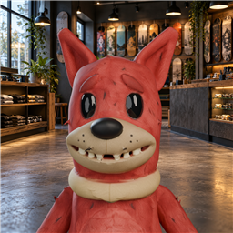
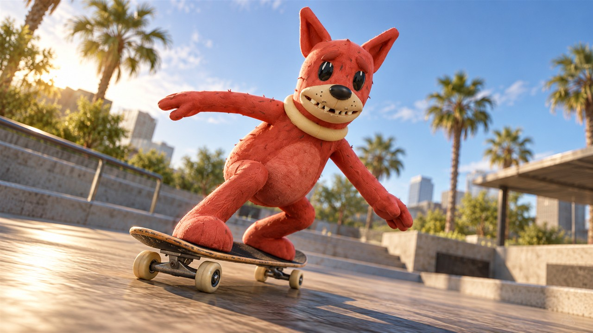

# Jittney Spear's Reese The Red Dog

**[Download v0.1.2](https://github.com/GittaOnTheTrack/reese-reskate/releases/tag/v0.1.2)** · [All releases](https://github.com/GittaOnTheTrack/reese-reskate/releases)

Download `JittneySpear-Reese_The_Red_Dog-0.1.2.zip` from the release assets. GitHub's automatic Source code ZIP is the documentation repository, not the installable mod.

Play as Reese, Jittney Spear's red dog character, in ReSkate. This is the **body-only** edition: the red surface and pale-yellow collar are included, while the separate 3D fur cards are not.

## Promotional images

The package icon shows Reese's actual 3D head in a skate-shop setting. Three approved 1280×720 promotional mockups are included in the `media` folder:

- `Reese_Skating_Plaza_Promo_1280x720.jpg` — Reese skating in a plaza.
- `Reese_90s_Desk_Flip_GameStyle_1280x720.jpg` — Reese doing a flip trick on a 1990s computer desk.
- `Reese_Bedroom_Map_Desk_Break_GameStyle_1280x720.jpg` — Reese taking a break in a Bedroom-map-inspired setting.

These images are mockups, not gameplay screenshots. The plaza and bedroom desk scenes are not locations included with this package; the Bedroom map is a separate community mod.

## Install and equip

Install this package through the ReSkate launcher or a Thunderstore-compatible mod manager. In the game, open **Skaters → Apparel → Costumes** and select **Reese Body Test**. That is the costume's current in-game label.

The native patch targets **skate. build 25414733**. ReSkate checks the build recorded in `.reskate-studio-patch`; a later game build may need a new package.

## Tested and known limits

Reese's body-only costume, corrected red surface, and collar were loaded and used in live skating on build 25414733 with ReSkate 2.0.2. The same installed patch loaded with Reese equipped in the Hub on ReSkate 2.0.7. Jittney Spear approved the body shape, movement, and corrected appearance in the earlier live test. A complete trick, all-angle lighting, and performance test has not been recorded. The 3D fur-card version is not included.

The costume currently appears in the game as **Reese Body Test**. Other full-body costumes based on the same game item may conflict. If Reese does not appear correctly, disable conflicting costume mods and reload.

## Credits

Reese character, model, and textures: **Jittney Spear**. ReSkate conversion and packaging: collaboration with Codex.

This is a community-created content mod and is not affiliated with Electronic Arts or the ReSkate team.

## Preview

Promotional mockup, not a gameplay screenshot:

## Repository contents

This repository contains release documentation and promotional artwork. The installable native patch is attached to Releases; editable model source is not included. No open-source license is granted by this upload.
